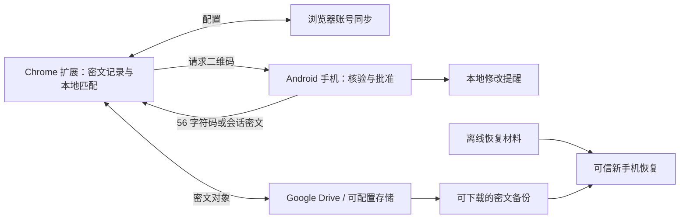

# 系统架构

> 2026-10-12 执行更新：用户已确认 docs/plan-review.md 为 P1 基线并授权开始技术验证。原文中“等待审核/未开始编码/不授权开发”等阶段描述已被本次授权取代；P1 尚未验收通过。实际证据与缺口见 [P1 报告](p1-report.md)，不把候选或原型当作真机通过。

2026-10-19 延续执行版，与 [整体方案](plan-review.md) 一致。取代初始草稿的双向扫码、对称整库封装及全量浏览器同步方案；当前实现范围限于 P1 技术探针，核心密码产品闭环未实现。

## 1. 系统边界

独立浏览器扩展负责保存与填充；手机负责记录核验、设备权限和逐条批准；用户选择的存储服务只承担密文对象同步。默认 Google Drive，不部署自建授权、中继或恢复服务。

首验 Windows 11＋Chrome、Android 14。手机推荐 Flutter＋Kotlin 安全模块，同一应用候选支持 Android 12+；Firefox 在首个闭环之后验收，iOS 后续采用同一协议及 Swift 安全模块。

## 2. 模块与职责

| 模块 | 职责 | 不应承担 |
| --- | --- | --- |
| 扩展 vault | 记录版本、目录、保存/更新、核验状态 | 手机私钥或批量凭据解密 |
| 扩展 authorization | 配对、请求、两种返回格式、临时会话 | 判断主机是否值得信任 |
| 扩展 form-adapter | 页面识别、来源匹配、用户触发填充 | 持久保存明文、直接访问云令牌 |
| 扩展 sync | 对象提交、拉取、冲突、重试 | 密码算法和移动端审批 |
| Google Drive / WebDAV adapter | 授权及密文对象 I/O、能力报告 | 获得记录/恢复私钥 |
| 手机 key-provider | Android Keystore 密钥创建与受限操作 | 将长期私钥导出给 Dart |
| 手机 approval | 可信显示、逐条确认、设备与记录权限 | 仅凭电脑标签判断记录身份 |
| 手机 transport | 二维码组帧、文本编码/分享 | 自动向联系人发消息 |
| recovery / backup | 材料生成、备份检查、可信恢复 | 依赖浏览器账号名称作解密秘密 |

共享规范、测试向量和状态机；TypeScript 与 Dart/Kotlin 分别实现平台适配。建议仓库为 `apps/extension`、`apps/authenticator`、`packages/protocol`、`packages/crypto-adapter`、`packages/test-vectors`，存储与表单适配不进入密码核心。

## 3. 主要数据流

### 保存与更新

电脑已固定手机/恢复公钥并获得仅用于匹配目录的密钥。每次凭据版本生成独立随机数据密钥，AEAD 加密用户名、密码及可信站点上下文，用 HPKE 分别封装给手机与恢复公钥。电脑可以离线保存新记录，不需要长期解密私钥；但该电脑能够观察它自己录入的新密码。

新版本先标为待手机核验，不允许静默覆盖手机已认可的内容。手机首次使用时核验并保存摘要/父版本检查点；签署凭证可在后续同步发布，离线本次不要求手输额外签名。

### 匹配与逐条使用

目录只包含域名及用户自行指定的非敏感别名，云端加密存储；配对后的电脑可持有目录密钥。它不能打开用户名或密码。手机从当前记录可信内容读取账号，不信任目录里的显示文本。

请求二维码包含当前记录信封和完整绑定信息，手机无需预先下载整库。用户批准后选择约 56 字符版本解密码，或加密给当前浏览器临时公钥的完整响应。手机同时可设置本地修改提醒。

### 同步与恢复

完整密文库通过 Google Drive 或可配置存储同步，浏览器同步仅存非敏感定位/配置。OAuth 与存储凭据按设备管理；新电脑仍需授权存储并与手机配对。账号切换不能自动合并密码库。

账号仅控制下载。可信新手机取得密文备份和离线恢复材料后创建新硬件密钥、逐条重新封装并重新配对。详见 [存储与恢复](storage-and-recovery.md)。

## 4. 浏览器与产品约束

- 普通扩展没有内置密码库通用读写 API，采用可信电脑 CSV 导入；导入不自动删除旧文件或原生密码。
- `privacy.services.passwordSavingEnabled` 可在权限与控制级别允许时关闭保存提示，不保证企业策略允许，也不清除已有条目或保证停止自动填充。
- 默认由用户触发填充，按站点申请访问权限；正常客户端检查来源、HTTPS、跳转及 iframe。管理员控制浏览器时不能把这些检查当作可信终端证明。
- 全部 JS/WASM 随扩展打包，不远程加载执行代码。手机通知受权限与系统调度限制，浏览器关闭时不承诺云同步实时运行。
- 不实现通用 Passkey 提供方或“主机管理员无法观察当前密码”的高保证模式。可在手机禁止向指定设备释放特定账号。
