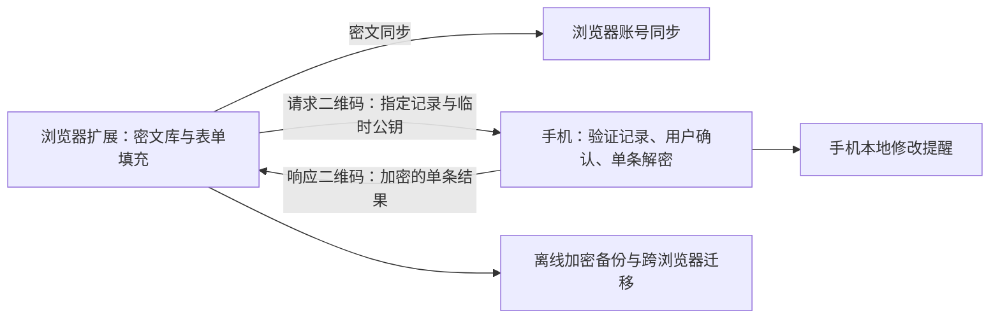

# 可行性评估与方案建议

日期：2026-10-12。本文保留初始可行性比较和资料核对过程；当前已收敛的产品选择与技术推荐以 [整体方案评审](plan-review.md) 及其技术文档为准，不把本文中早期候选视为现行决策。

> 后续反馈已收敛为 Windows 11＋Chrome、Android 14/Flutter 候选、全量外部密文存储、手机扫电脑＋约 56 字符返回码；允许用户通过通信工具传入，建议该路径另提供会话加密响应，见 [当前方案](offline-manual-authorization.md)。本文保留基础评估；双向二维码和纯浏览器小容量同步已不作为首版推荐，原生双手机 UI 方案也调整为 Flutter＋原生安全模块候选。

> 最终产品补充：默认存储 Google Drive，用户可指定存储；账号只下载密文，独立离线恢复密钥负责解密。旧架构/协议文档已完成一致性修订，第 9 节记录的是修订前发现的问题。

## 1. 结论

可以实现“浏览器只持久保存密文、手机逐条授权使用、使用后在手机提醒修改密码、无自建服务器”。但需要把“改写浏览器内置密码库”调整为“独立扩展密码库”，并接受：受控电脑能够截获当前交给它使用的密码及登录会话。

建议产品定位为：**以手机作为授权边界的独立密码库，降低高风险电脑造成的整库泄露风险。** 这比“任何环境下安全使用所有密码”更准确，也可以形成可验收的工程目标。

浏览器保存的密码不应笼统理解为磁盘上的明文：浏览器已有系统密钥、加密存储或主密码机制。这里的不足是解锁和使用权限仍在受控主机上，以及 CSV 导出通常为明文。新方案改变的是授权与密钥所在的设备。

## 2. 原始需求可行性

| 原始需求 | 结论 | 推荐实现或必须接受的边界 |
| --- | --- | --- |
| 替换内置保存密码功能 | 使用体验可替代；普通扩展不能替换其底层存储 | 扩展负责保存、匹配和填充，建立独立密码库 |
| 在内置密码条目中保存密文并复用原生密码同步 | 不作为可上架普通扩展的实现路径 | 没有公开、通用的内置密码库读写 API；不使用私有 API、浏览器数据库修改或 UI 自动化绕过 |
| 每次只解开一个账号 | 可以 | 手机逐条审批，响应只包含该动作需要的字段，不给电脑整库密钥、恢复密钥或长期解密能力 |
| 只输入普通 Authenticator 的 6 位码 | 无法单独达到上述隔离目标 | 使用专用手机 App 的密钥与可信确认界面；6 位码不作为记录加密密钥 |
| 解密后手机提醒修改密码 | 可以 | 手机在批准时创建本地通知，支持关闭、延后、自定义；无法离线可靠判断网页登录是否成功 |
| 处理已有浏览器密码 | 可以通过迁移实现 | 在可信电脑上用户主动导出 CSV、导入扩展、验证恢复，然后由用户清理原生副本 |
| 浏览器账号同步、多设备迁移 | 有条件可行 | 扩展密文使用 storage.sync；容量很小，Chrome 与 Firefox 不互通，且依赖账号同步是否可用 |
| 极高加密强度 | 可以明确为工程基线 | 标准密码算法、硬件保护、逐条授权、供应链与独立审计；不是绝对安全或信息论安全 |
| 无额外通信 | 需重新定义 | 可不自建服务器、不使用网络授权；二维码仍是通信。浏览器自身的云同步仍使用网络 |
| 后续扩展书签等 | 可以预留 | 复用密文对象和授权接口，按数据类型分别设计权限、容量和泄露边界 |

## 3. 受控电脑上的安全边界

### 可以争取的保证

- 电脑、扩展目录、浏览器同步服务仅持有记录密文和明确允许暴露的元数据。
- 即使电脑被管理员控制，未获得手机批准的其他记录仍受手机端密钥保护。
- 手机拒绝批量释放、未登记设备、越权记录、被替换的记录版本和无效请求。
- 手机显示经过验证的记录站点、账号、请求设备和动作，由用户确认；审批不依赖电脑声称“已经验证过”。

### 不能保证的事情

- 已填入网页或显示在电脑上的密码可被管理员、恶意浏览器、网页脚本或恶意扩展记录。一次授权不是一次性密码；被记录后可重复使用，直至网站修改密码或撤销凭据。
- 电脑可以保存响应及其临时私钥。短有效期和清理内存只能约束正常客户端，不能让恶意电脑已经拿到的秘密自动失效。
- 手机无法仅凭电脑提交的域名、签名或截图，证明电脑真的处于该网站或提交到了正确页面。设备签名证明密钥持有，不证明电脑安全。
- 手机显示正确账号也不能阻止受控电脑劫持登录后的 Cookie、会话或操作。Passkey 能减少可复用密码泄露，不能让受控终端上的会话变安全。
- 多次批准不同账号后，攻击者可以累计收集这些账号的密码。需要手机端账户白名单、风险设备标记和拒绝整库授权来限制影响。
- 完全离线的其他手机不能立即获知吊销。旧密文、历史备份以及已经释放的秘密不能远程收回。

对于高价值账号，建议手机策略直接禁止向办公设备释放密码，改为在可信手机上操作，或使用网站原生支持的 Passkey/硬件密钥。首版可提供“禁止释放密码”的策略，不承诺实现通用 Passkey 提供方。

## 4. 推荐架构

### 密钥与保存流程

推荐每条记录、每次内容更新生成独立随机 256 位数据密钥。数据使用标准 AEAD 加密；数据密钥通过标准公钥信封分别封装给已登记手机以及可选的离线恢复公钥。电脑只需要收件方公钥即可保存新记录，无需拿到手机私钥或整库主密钥。

这解决旧草稿中“电脑没有 K_vault，却需要使用 K_vault 封装新记录”的缺口。初始公钥必须经过可信配对固定；在已被控制的电脑上新输入或新生成的密码，本来就可能被该电脑观察。

公钥加密不等于可信来源：任何持有手机公钥的人都能生成可解密对象。新建记录应标为“未由手机核验”；手机核验后签署记录标识、版本、密文摘要及权限等必要字段。已有已核验记录不能被电脑静默替换成不同内容或不同站点。手机需保存必要的版本检查点；对从未见过的记录和已丢失检查点不能声称拥有完整的回滚检测能力。

### 单条使用流程

1. 扩展根据允许暴露的索引或用户选择找到一条记录，生成随机挑战和临时响应公钥。
2. 请求二维码携带该记录的密文信封、版本、可信签署信息、动作、挑战、临时公钥和设备认证信息。若手机并未保存密码库，不能只传 recordId。
3. 手机先按本地安全策略解锁查看上下文，验证对象、设备权限和记录真实性，显示站点、账号及动作。每次释放均需要独立确认，不存在“本次全部允许”。
4. 手机仅释放该动作需要的字段，加密给本次临时公钥并签署完整请求绑定信息。原则上不返回记录数据密钥，以免额外释放同条记录中不必要的字段。
5. 扩展验证并填充；手机可同时创建修改提醒。正常客户端使用后清理会话与引用，但不承诺 JavaScript 内存绝对擦除。

采用标准 HPKE 解决公钥信封和响应保密性；请求认证、可信记录、设备权限、重放缓存、版本检查和交互仍是应用协议责任。HPKE 自身不提供这些全部保证，也不对长期接收私钥被攻破提供历史密文前向保密。

## 5. 同步容量是主要产品约束

根据当前官方文档，Chrome 与 Firefox 的扩展同步配额均为：总计 102,400 字节、单项 8,192 字节、最多 512 项；以键和值的 JSON 序列化等规则计量。`unlimitedStorage` 不会扩大同步配额。Chrome 还有每分钟/每小时写入限制。

假设每条记录包含多个收件方信封、签名、索引和编码后占 0.8–2 KiB，并预留约 20 KiB 给清单、冲突与提交过程，总量可能仅容纳约 40–100 条。这只是容量预算示例，不是实测上限；长备注、多手机和备份字段会继续减少数量。

分片只能解决单项限制，不能扩大总容量。密文通常不可有效压缩，不应把压缩密文当作容量解决方案。同步也不是可靠备份：账号不可达、配额不足、误删和冲突需要独立处理。

建议二选一：

- 浏览器同步仅存精选工作账号；完整库通过离线加密包备份和迁移。最贴近“少量信息在风险设备上使用”的初始需求。
- 需要数百至上千条自动同步时，允许用户选择文件同步服务或自建密文存储。此时必须接受额外传输渠道；不能承诺只依靠原生扩展同步完成。

Chrome 账号和 Mozilla 账号分别同步，不跨生态。Firefox 官方说明桌面同步有周期；Firefox for Android 不同步扩展数据。首版建议限定桌面扩展，手机使用专用 App。

同步协议需处理多个键非事务提交、掉电、并发修改、删除与更新冲突、旧版本回放和配额不足。优先显示冲突并保留可恢复内容，不用最后写入时间静默覆盖密码。具体提交与清理方案必须通过容量原型后确定。

## 6. 元数据与自动匹配的取舍

若电脑按当前网站自动查找账号，它至少需要某种可查询的站点信息。

| 方案 | 体验 | 对受控电脑的保护 |
| --- | --- | --- |
| 保存域名与非敏感标签，用户名仍加密 | 能快速匹配，推荐用于工作账号 | 电脑知道站点与标签；密码仍逐条保护 |
| 在电脑保存 HMAC 索引密钥 | 能匹配 | 电脑可枚举常见域名；不能声称对受控电脑隐藏站点 |
| 站点和账号均隐藏，由手机选择 | 隐私更强，操作更多 | 需要手机持有可检索目录或额外交互；电脑仍可观察使用时的目标和释放字段 |

旧草稿将 K_index 仅放在手机，同时让电脑本地匹配 HMAC，流程不闭合。需先确认元数据政策，再选择方案。

## 7. 技术选型建议

以下是可评审候选，不是已确认决策。首版采用一个算法套件，避免堆叠可配置算法或提前维护多套兼容实现。

| 层 | 推荐 | 原因与验证点 |
| --- | --- | --- |
| 扩展 | TypeScript + WXT + WebExtensions；Chromium MV3 优先 | 双浏览器构建与页面逻辑可共享；Firefox 后台生命周期、权限差异需要真实验证 |
| 扩展界面 | React + TypeScript | 便于实现导入、设备与账号管理；开始页面设计前读取本机 DESIGN.md |
| 组织方式 | pnpm workspace，原生手机项目同仓独立构建 | 协议规范、测试向量共享；不为共享而强行把手机安全存储移到 JavaScript |
| Android | Kotlin + Jetpack Compose + Android Keystore | 原生用户认证与硬件密钥访问；硬件 ECDH 路线建议以 Android 12/API 31+ 为候选下限，待设备确认 |
| iOS | Swift + SwiftUI + CryptoKit/Secure Enclave | 优先原生安全能力；需要 macOS/Xcode 和真机验证，当前 Windows 工作区无法完成原生发布验证 |
| 记录 AEAD | AES-256-GCM，独立随机记录密钥，严格 nonce 规则 | 原生平台支持较广；每次记录更新新密钥，避免跨设备复用 key/nonce |
| 公钥信封 | RFC 9180 HPKE：P-256/HKDF-SHA-256/AES-256-GCM 候选 | 与手机硬件能力对接；须核实各端库是否支持使用不可导出私钥执行 KEM，不能只看算法名称 |
| 设备和记录认证 | 独立 P-256 ECDSA 签名密钥 | 签名与解密密钥分离；浏览器设备密钥不作为主机可信证明 |
| 二维码协议 | 规范 CBOR，二维码编码与分帧通过原型定案 | 先实测摄像头、光照、载荷和往返次数；不预设“大二维码一定可用” |
| 手机提醒 | 本地通知 | 无需推送服务器；受通知权限和系统调度影响，不承诺精确时刻必达 |
| 恢复 | 独立高熵恢复密钥 + 加密备份 | 恢复材料与密文备份分开保存；可选口令保护使用 Argon2id，不接受短 PIN 作为恢复安全根 |
| 验证 | Vitest/属性测试、浏览器集成测试、JUnit、XCTest、跨端向量 | 协议异常与恶意输入测试优先；商店发布前做独立安全审计 |

AES-256 不意味着系统拥有“256 位整体安全强度”：P-256 的传统攻击安全强度约为 128 位；该候选不是抗量子方案。若“极高”明确包含长期抗量子要求，必须另立混合 KEM 评估，考虑硬件支持、库成熟度及二维码体积，不能简单替换算法名称。

普通 FIDO2 安全钥匙不能一概视作任意密文解密设备。WebAuthn PRF、PIV/OpenPGP 等能力取决于具体型号、浏览器和桥接方式；没有可信显示屏时也难以核对每次授权的账号。建议首版专用手机 App，硬件锁另做具体型号验证。

## 8. 浏览器、导入与发布

- Chrome 和 Firefox 都提供 `privacy.services.passwordSavingEnabled`；扩展可在授权和设置控制级别允许时关闭原生保存提示。企业策略或其他扩展可能阻止设置，不承诺强制生效；关闭保存提示也不等于删除已有密码或禁止已有密码自动填充。
- 导入应在可信个人设备进行。已有 CSV 及原生密码副本不会因重新加密自动消失；删除文件也不代表操作系统、备份或同步历史中彻底抹除。
- 公司电脑登录原有浏览器账号时，旧的内置密码、历史和会话可能已经同步。应先在可信设备完成迁移及同步配置核对，再使用新的办公配置文件；不能期待插件事后消除已发生的泄露。
- CSV 导入支持官方字段和常见编码、多行引号、重复记录、损坏行与预览确认。Chrome/Firefox 导出基线按 CSV 处理；不默认支持未经定义的 JSON 格式。
- 不依赖浏览器 UI 自动化、私有 password API 或直接写密码数据库；这些不能形成稳定且可审查的扩展方案。
- 发布需要最小权限、隐私政策、完整打包的 JS/WASM、可审查源码和稳定扩展 ID。Firefox 需按分发渠道签名；GitHub 发布不自动解决签名、安装限制和商店账号归属。
- 企业可以禁止扩展安装、浏览器同步、相机和 USB。产品不绕过管理策略，需提前确认目标办公环境是否允许必要能力。

## 9. 现有草稿审查记录

原有文档保留以供参考，但“已接受”不视为当前会话确认。本次审查需纠正：

1. 原生保存设置并非只能由用户或企业策略控制；存在扩展隐私 API，受控制级别限制。
2. 无 K_vault 的扩展不能按原文完成新记录封装；推荐改为公钥收件方信封。
3. 不在手机存整库时，请求仅有 recordId 不足以解密，必须传密文或先完成可信迁移。
4. 仅手机掌握 HMAC 索引密钥与电脑自动匹配互相冲突。
5. 信任浏览器本身未被攻破的假设，不能支撑对管理员完全受控电脑的目标，需要分别描述两种攻击模型。
6. 响应过期、单动作标签和清理引用无法限制恶意接收端再次使用已经获得的密码。
7. 硬件私钥不可导出与恢复不能仅靠一句“导出恢复包”连接；必须明确独立恢复收件方与密文备份。
8. 约 100 KiB 的总同步配额、真实传输载荷、记录来源认证和回滚边界需要先验证。

## 10. 一手资料

2026-10-12 核对以下官方页面；文档检查不代替真机原型。Apple 页面本次只能读取到需 JavaScript 的提示，iOS 具体能力保留为待验证项。

| 来源 | 用途 |
| --- | --- |
| [Chrome 扩展 API 目录](https://developer.chrome.com/docs/extensions/reference/api) | 公开 API 范围，无普通扩展内置密码库通用读写接口 |
| [Chrome storage](https://developer.chrome.com/docs/extensions/reference/api/storage) | 102400/8192/512 配额、写入限制、访问范围 |
| [MDN storage.sync](https://developer.mozilla.org/en-US/docs/Mozilla/Add-ons/WebExtensions/API/storage/sync) | Firefox 配额、同步周期、Android 限制、冲突行为 |
| [Chrome privacy](https://developer.chrome.com/docs/extensions/reference/api/privacy) / [MDN privacy.services](https://developer.mozilla.org/en-US/docs/Mozilla/Add-ons/WebExtensions/API/privacy/services) | 原生保存提示控制 |
| [Chrome types](https://developer.chrome.com/docs/extensions/reference/api/types) | 设置控制级别与不可控制状态 |
| [Android Keystore](https://developer.android.com/privacy-and-security/keystore) | 硬件密钥、StrongBox、用户认证与能力检查 |
| [Android KeyProperties](https://developer.android.com/reference/android/security/keystore/KeyProperties) | PURPOSE_AGREE_KEY 从 API 31 提供 |
| [RFC 9180](https://www.rfc-editor.org/rfc/rfc9180.html) | HPKE 套件、测试向量及重放/前向保密非目标 |
| [Chrome Web Store 政策](https://developer.chrome.com/docs/webstore/program-policies/policies) | 最小权限、隐私政策与打包代码 |
| [Chrome 远程代码规则](https://developer.chrome.com/docs/extensions/develop/migrate/remote-hosted-code) | JS 与 WASM 需随扩展提供 |
| [Firefox Add-on 政策](https://extensionworkshop.com/documentation/publish/add-on-policies/) | 源码可审查、远程代码与数据披露要求 |
